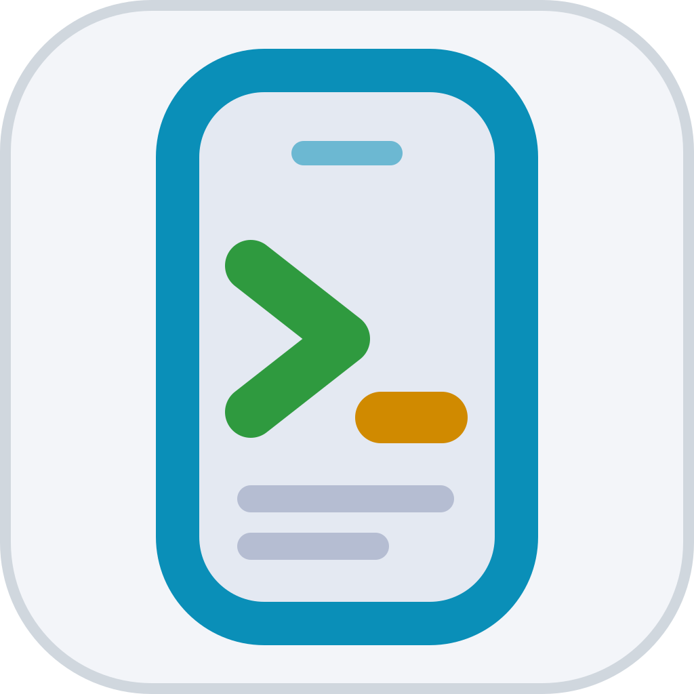

<p align="center">
  <picture>
    <source media="(prefers-color-scheme: dark)" srcset="assets/logo-dark.svg">
    <source media="(prefers-color-scheme: light)" srcset="assets/logo-light.svg">
    
  </picture>
</p>

# lazymobile

[](https://github.com/0xrnp/lazymobile/actions/workflows/ci.yml)

A terminal dashboard for mobile development: iOS simulators, Android emulators, connected phones,
their logs, and Expo builds, in one screen. It works in any terminal, and inside Neovim or
another editor's terminal.


<details>
<summary>More screenshots</summary>

The device list:


The log of one app on an Android emulator, with its crash in red:


Every key, with `?`:


</details>

- One list for every simulator, emulator, iPhone and Android phone on the machine.
- Boot, cold boot, shut down, erase, create and delete simulators and emulators.
- Uninstall an app, with its data, from a simulator, emulator, iPhone or Android phone.
- Launch, restart or stop an app on a running device.
- Open a deep link, take a screenshot, and switch dark and light mode, on a simulator, emulator or Android phone.
- For an app in development on an Android emulator or phone: forward a port to this computer (Metro's 8081), open the app's developer menu and reload it, with `lazymobile dev`.
- Install an `.apk` or `.app` from the devices pane (`i`), offering the builds it finds in the folder and the ones you installed before. On an iPhone too.
- Run your project's own commands (`flutter run`, a Gradle task, anything) on the selected device, from `.lazymobile.json`. The dashboard shows the exact command and asks first.
- Record the screen of a simulator, emulator or Android phone to a video, from the command line.
- Put a simulator or emulator at a place, and give it the tidy status bar of a screenshot.
- Grant or revoke an app's permission, and clear its data, on a simulator or emulator.
- Connect Android phones over Wi-Fi (pairing code or address).
- The latest crash report of an app, on a simulator or an Android emulator or phone, readable in the
  dashboard (`o`, then the app) or with `lazymobile crash`, and saved to a file with `--save`.
- What changed: `lazymobile changelog` prints the notes of this version, and the dashboard shows
  what is new once after an upgrade. The notes are built in, so reading them needs no network.
- A bug report in one command, `lazymobile report`: a new folder with a screenshot, the app's last
  log lines, its latest crash report, and the device and app version, ready to attach to a ticket.
- Live logs: filter by app, level and text. An Android app is followed across restarts. Open as
  many logs as you like, side by side or stacked, to read several devices at once.
- Inside an Expo project: list EAS builds, install a finished build on a running simulator or
  emulator, start and cancel builds.
- `lazymobile run`: pick a device, start it if it is off, and run this folder's app on it with the
  tool you already use (`flutter run`, or your own command), with its keys such as hot reload
  working as before.
- The same features as plain commands, with `--json`, for scripts and coding agents.
- An MCP server for coding agents, with `lazymobile mcp`: boot, install, launch, screenshot and read
  logs, without the commands that erase data.
- `lazymobile doctor` says what is missing and how to install it. `doctor --fix` shows the command for each fix and runs it only after you say yes. It also checks `idevicesyslog` when an iPhone is connected, and the Expo login inside an Expo project.
- One binary. It calls the tools you already have (`xcrun`, `adb`, `emulator`, `eas`).

Requirements: macOS or Linux. iOS needs macOS with Xcode. Android needs the Android SDK (Android
Studio or the command-line tools). The builds pane needs the `eas` command.

## Status

Early release. What has been run, and what has not:

| | Tested |
| --- | --- |
| `run` | A real Android emulator (Pixel 9a) with Flutter 3.38.10 and a new Flutter app: `lazymobile run Pixel_9a` started the emulator, ran `flutter run -d emulator-5554`, the app opened, and `r` gave a hot reload. Flutter only was run, on Android |
| Dashboard following a run | A real Android 16 emulator (Pixel 9a) and the Flutter app, with the dashboard and `lazymobile run` in two tmux panes: the dashboard selected the device and said to pick the app, I picked it once, and after closing its log, a new run made the dashboard open the app's log by itself with its lines. Not run: an iOS simulator, a phone, two devices at once, and Neovim's terminal |
| `run --split` | A real iOS 27.2 simulator and a scratch project whose `run` action is an `echo`: the dashboard opened in a new pane to the right in a real Rex terminal, in tmux 3.8 and in Zellij 0.46, each in the project's folder and with the focus left on the tool's pane (not in Zellij, which cannot), and selected the simulator with the "pick the app" note. Also found and fixed: a tmux inside Rex was split as Rex. Not run: with a Flutter or Expo build, WezTerm and Kitty |
| `run --here` | A real terminal (tmux 3.8). With `flutter run` and a new Flutter app on a real Android 16 emulator (Pixel 9a), which lazymobile started first: the tool ran in the left pane, `r` gave "Reloaded 0 libraries" and `R` "Restarted application", `ctrl+o` then `l` opened the app picker over the run view and then the app's log on the right, `ctrl+]` showed the full dashboard with that log and the tool still running, and `q` there asked, then stopped `flutter run` within a second, leaving no `flutter run` process. The second run in that folder opened the app's log by itself, and `q` in the tool's pane ended Flutter as it would outside, leaving its output and "ended". With an interactive scratch script on an iOS 27.2 simulator: keys reached the script and not the dashboard, `enter` ran it again after it ended, and quitting left no process. From a screenshot of the maintainer's own run: a real Expo app with a development client on an iOS 27.2 simulator ran with `--here`, with its Metro output on the left and the app's log on the right, its errors in red. Resizing with `shift+←` and `shift+→` from the tool's pane, and hiding and showing the log with `ctrl+p` then `l`, were run in tmux 3.8 on an iOS simulator. A terminal that sends nothing different for Shift with an arrow would need the drag or the menu. Not run: a real phone, WezTerm or Kitty, and Linux apart from the end-to-end tests with fake tools in a container |
| Quick menu (`ctrl+p`) | A real iOS 27.2 simulator, with `run --here` in a real terminal (tmux 3.8): `s` saved a PNG and macOS held it as a picture (276 KB), `r` then `r` filmed about 3 seconds, saved a `.mov` and macOS held it as a file, and quitting left no process. The macOS copy commands were also run on their own: a PNG as a picture, a file with a space in its name as a file, and text, with the real `osascript` and `pbcopy`. The built binary was run end to end with fake `adb` and clipboard programs on macOS and in a Linux container: a screenshot, a recording, quitting while one runs, and the log copy. The Linux copy script was run for real with fake `wl-copy` and `xclip` programs: text, a picture, a file name with spaces and shell characters, and the fall back to `xclip`. Not run: an Android emulator or phone, the real `wl-copy` and `xclip`, an AI reading what was pasted, and the clipboard over SSH |
| Simulator and emulator size, and unavailable simulators | The size of each Android emulator (its AVD folder: images and quick-boot snapshot) shown beside the simulators, against the maintainer's three real AVDs (6.6 to 7.7 GB, and `list` agrees with `du`). `list`, `list --json` and `delete --unavailable` without `--yes` against the maintainer's real simulators (22 in `simctl`, 10 of them unavailable after an update, 2.0 GB): the size of each simulator in a column, the 10 listed with their runtime and size, and nothing deleted. The dashboard in a real terminal showed the column and "10 simulators Xcode can no longer run use 2.0 GB", and `U` asked, naming eight of them. `xcrun simctl delete unavailable` itself was run in a separate throwaway device set: it deleted only the unavailable simulator and its folder, and left the usable one. The deletion by lazymobile was run only against fake tools, so it was not run on the maintainer's own simulators. Not run: Xcode versions other than the one here, and an older `simctl` that reports no sizes (parsed from a fixture only) |
| `run` asking which way and which device | A real terminal (tmux 3.8) and a scratch project with two `run` actions in `.lazymobile.json`: the list appeared, `j` and Enter chose one and ran it on the one running iOS 27.2 simulator, the next run did not ask, `--choose` asked again for the device (two simulators with one name were told apart by id), and Esc stopped without running anything. Not run: with Flutter or Expo, or with a real phone in the list |
| `run` for Expo | A real Expo app with a development client, in a pnpm monorepo, on an iOS 27.2 simulator: `lazymobile run <simulator> -- --no-install` started the simulator and ran the project's own `expo run:ios --device <id>`. The app built, installed and opened on that simulator, and Metro started and reported the app's own error, a workspace package that `pnpm install` had not linked yet. Before macOS Automation was allowed for System Events, Expo stopped at the end with its own `osascript` error (-1743), and lazymobile showed it and exit code 1 as it came. Later, from a screenshot of the maintainer's own run with `--split` in Rex: Expo ran in one pane (the QR code, its key menu, the bundle at 67%) and the dashboard in the other selected the simulator and showed the app's log lines. Not run: hot reload, the app past its bundling, Android, and a physical phone. The project's files were not changed by lazymobile |
| `run` for the rest | Not run: an iOS simulator with Flutter, an iPhone, a project with its own `run` action in `.lazymobile.json`, and React Native. Those paths are tested with fake tools only |
| `dev` (reverse, menu, reload) | A real Android 16 emulator (Pixel 9a), from the command and from the dashboard key `D` in a real terminal: `adb reverse` was set (checked with `adb reverse --list`), and the menu and reload keys were accepted by adb. Not run: a React Native app on it, so that the menu opening and the reload happening were not seen. A simulator and an iPhone are refused (no way to send a key) |
| Unit tests | Full suite on macOS, with fake `xcrun`, `adb`, `emulator` and `eas`. CI runs it on Ubuntu and macOS |
| Listing devices, `doctor`, opening the dashboard | Real Xcode 27.2 and Android SDK on macOS |
| Android emulator boot, shut down and logs (`logcat`) | A real emulator on macOS |
| iOS simulator boot, shut down, installing an app, and both kinds of logs | A real simulator on Xcode 27.2, with a real React Native app |
| Erase, create and delete simulators | Fake tools only in this program. The same commands were run on real simulators and emulators in [devices.nvim](https://github.com/0xrnp/devices.nvim), which this logic is ported from |
| Expo builds pane | Listing, details, and downloading and installing Android and iOS simulator builds, with eas-cli 24.7 and a real Expo project. Starting and cancelling builds have only been run with a fake `eas` |
| iPhones | Listed over USB with a real iPhone, and so were its installed apps with their version and build, which also shows in the log heading. Its logs have only been tried with fake tools |
| App version in the log heading | A real Android emulator (Android 16), a real iPhone over USB and a real iOS simulator, with Xcode 27.2. Not run: Xcode 26 or older, other Android versions, Android phones, Wi-Fi iPhones |
| Several logs at once | Four real system logs of an iOS simulator, in a real terminal: a grid, stacked and one at a time, the list (`a`) closing one, and quitting and coming back with the rest restored. Also a simulator's log beside a real iPhone's launch-an-app log (the launch faked). Not run: more than four logs, or Android logs in several panes. The rest is covered by tests with fake tools |
| Installing from the devices pane | The picker and its path checks, only with fake tools, and the installs through `simctl` and `adb` as before. On a real iPhone only the failure was run, with a path that does not exist, and `devicectl` refused it. A real install on an iPhone was not run, because that needs a signed device build |
| Uninstalling an app | A real iPhone that lazymobile listed as connected over Wi-Fi (it was first paired over USB), and Android, both run by the maintainer. The app list of a real simulator and refusing an app that is not installed were also run. Not run: a real removal on a simulator |
| Launching, restarting and stopping an app | A real iOS simulator (Xcode 27.2) and a real Android 16 emulator, from the commands. An app that is not installed was refused on both. Not run: an iPhone or an Android phone, other Xcode or Android versions, the dashboard key in a real terminal |
| `--json` failures and results | The real program on macOS: a failure, a usage mistake, `id`, and `boot` and `shutdown` of a real simulator. The other commands, and `logs --json` ending in a failure, only with fake tools |
| `logs --tail` and `--since` | A real iOS 27.2 simulator and a real Android 16 emulator (Pixel 9a): the last lines, a time window, one app and a level, with the command ending by itself. An iPhone is refused (it keeps no history). Not run: an Android phone, an app crash in the window |
| Update note | The real program built as version 0.3.0 against GitHub's real release list: one line said 0.4.0 was out, and the answer was saved with its time. With `LAZYMOBILE_NO_UPDATE_CHECK=1` nothing was asked and nothing was saved. Not run: a day passing, a computer without a network, and a rate limit (tested only with a fake server) |
| What is new (`changelog`) | The real program built on macOS: `lazymobile changelog`, with a version and with `--all --json`, and the dashboard in tmux with a build whose notes had a 0.5.0 entry and a saved last version of 0.4.0: the notes opened over the dashboard and the version was saved. Not run: a real upgrade from an installed release, and a second start (tested only with a fake dashboard) |
| Bug report (`report`) | A real iOS 27.2 simulator (Settings app) and a real Android 16 emulator (Settings app): a new folder with a screenshot, the last log lines, a crash report when there was one, and a summary. Not run: an app you built, an Android phone, a crash report on the simulator, and the app version of an installed app (the Settings apps are not in the installed list). An iPhone is refused. Found on the way: a log read within seconds of launching an app came back empty on the simulator, since the system log is written to disk a little later |
| Crash reports (`crash`) | A real iOS 27.2 simulator and a real Android 16 emulator (Pixel 9a), from the command: a Safari crash on the simulator (from the Mac's crash reports, matched to that simulator), and on the emulator a Java crash of the Clock app and a native crash of the Bluetooth app from the crash buffer. `--save`, `--json`, a file that exists refused, an app with no crash, and an iPhone refused. The dashboard menu (`o`, then the app) on the emulator in a real terminal. The fallback to Android's dropbox, only with saved real output. Not run: an Android phone, a React Native or Flutter app's crash, a crash older than a restart |
| Crash marking | A real crash of an Android 16 emulator's Settings app (`am crash`), streamed with `logs --json`: the report's lines were marked. The `e` keys in the dashboard, only with fake log lines. Not run: an iOS crash, a React Native error, a native signal. Their patterns come from known log formats |
| Links and screenshots | A real iOS 27.2 simulator and a real Android 16 emulator, from the commands: a web address with `&` in it, a link no app handles, a PNG saved, and a second screenshot to the same file refused. The dashboard keys `p` and `t`, only with fake tools. Not run: an Android phone, other Xcode or Android versions |
| Dark and light mode | A real iOS 27.2 simulator and a real Android 16 emulator, from the commands: read, switch both ways, and a bad mode refused. The dashboard key `m`, only with fake tools. Not run: an Android phone, Android before 10 (expected to say it needs Android 10), other Xcode versions |
| Screen recording | A real iOS 27.2 simulator and a real Android 16 emulator, from `record`: a video of valid format saved with `--duration` and with Ctrl-C, a second recording to the same file refused, Android's 3 minute limit refused, and the copy on the device removed. No dashboard key yet. Not run: an Android phone, an iPhone (Apple's tools cannot record one), videos longer than a few seconds |
| Location and status bar | A real iOS 27.2 simulator and a real Android 16 emulator, from the commands. The status bar was checked in real screenshots (9:41 and 12:00, full battery and signal). The location was accepted by both tools, and a latitude off the globe is refused here before it reaches them. Not checked: that an app inside the device sees the new place. The dashboard keys `f`, `c` and `C`, only with fake tools |
| Permissions and clear data | A real iOS 27.2 simulator and a real Android 16 emulator (API 36), from the commands. On Android a grant and a revoke were checked in the package manager (`granted=true`, then `false`). Refusals were run too: an app that is not installed, a permission the app does not ask for, a made-up name, and clear data without `--yes`. The dashboard menu, only with fake tools. Not run: other Android versions (photos and notifications use different permissions before Android 13), real phones, which are left alone |
| Project actions (`.lazymobile.json`) | The `action` command with the real program on macOS and a real iOS 27.2 simulator: the list, the command shown without `--yes`, and a command run with the device filled in. The loader and its checks, and the dashboard key `R` with its confirm window, only with fake tools. Not run: the hand-over of the terminal to a long command such as `flutter run` in the real dashboard, and an Android device |
| Log filter words, exclusions and regular expressions | The parser with many cases, and the dashboard with fake log lines only. Not run against a real device's log |
| Saving a log as JSON | The file written from fake log lines in the tests. Not run in a real dashboard |
| Saved filters (`P`) | The saved file and the dashboard keys, with fake log lines only |
| Boot and install on several devices | `boot --all` with the real program and real iOS 27.2 simulators: two booted together with `--wait`, a real iPhone left alone, a second run skipping both. `install --all`, sets and Android emulators only with fake tools |
| `doctor --fix` and the new checks | The real program on macOS with Xcode 27.2: the checks on a healthy machine, `idevicesyslog` found with a real iPhone connected, and with it hidden from PATH the fix `brew install libimobiledevice` was offered and, without a terminal, only printed. Not run: a fix command itself, the Expo login check against a real Expo project, the Xcode license and Android SDK fixes (fake tools only) |
| Android phones | A real Android phone |
| `idevicesyslog` (an iPhone's system log) | An iPhone's system log for one app (`logs --mode system --app <id>`), matched to the running process through `devicectl`: only that app's lines came through, on a real iPhone 17 Pro (iOS 27). An app that is not running gives a clear error (tests). Not run: Android, the dashboard key path |
| Linux | The dashboard on Linux, and a Homebrew install in a Linux container (arm64). The suite runs in CI on Ubuntu |
| Mouse and trackpad scrolling | A real terminal on macOS |

If something fails for you, please
[open an issue](https://github.com/0xrnp/lazymobile/issues/new/choose) with the output of
`lazymobile doctor`.

## Supported versions

lazymobile runs on macOS and Linux. Windows is not supported. iOS needs macOS with Xcode.

| | Run for real | Meant to work, not run |
| --- | --- | --- |
| Xcode | 27.2 | 26 and earlier: the simulator window opens in Simulator.app, not DeviceHub. Tests cover both, with fake tools. iPhones need Xcode 15 or newer (`devicectl`) |
| Android | Android 16 emulator, a real phone | Older and newer versions. Apps are listed with `pm list packages -3` and started and stopped with `monkey` and `am force-stop`, which older releases also have |
| Linux | The dashboard, and Homebrew in a container | Every distribution |

A version in the right column has not been run. If you use one, say what happened in an
[issue](https://github.com/0xrnp/lazymobile/issues/new/choose) with the output of
`lazymobile doctor`.

## Install

With [Homebrew](https://brew.sh), on macOS or Linux:

```sh
brew install 0xrnp/tap/lazymobile
```

With Go 1.27.4 or newer:

```sh
go install github.com/0xrnp/lazymobile/cmd/lazymobile@latest
```

Or download a binary for macOS or Linux from the
[releases page](https://github.com/0xrnp/lazymobile/releases), unpack it, and put `lazymobile` on
your `PATH`.

Then run `lazymobile doctor` to see what it found.

## The dashboard

Run `lazymobile`. Run it inside an Expo project to also get the builds pane.

Devices:

| Key | Action |
| --- | --- |
| `j` `k`, arrows | Move |
| `b` | Boot |
| `B` | Cold boot an emulator (ignore its snapshot) |
| `s` | Shut down |
| `l`, `enter` | Logs. Every log opens in a pane of its own, beside the ones that are open |
| `e` | Erase a simulator, or wipe an emulator's data. Asks first |
| `d` | Delete. Asks first |
| `U` | Delete the simulators Xcode can no longer run, such as after an update removed their runtime. The pane says how many there are and how much disk they use. It names them and asks first, then runs `xcrun simctl delete unavailable` once. A simulator that can run is never touched |
| `o` | Pick an app, then what to do with it: launch, restart or stop it, show its latest crash report, or save a bug report (a new folder here, as `lazymobile report` makes). On a simulator or emulator also grant or revoke a permission, and on an emulator clear its data (asks first). An iPhone's apps can be launched and restarted, not stopped, and its crash reports stay on the phone, so it has no bug report |
| `f` | Put a simulator or emulator at a place (latitude,longitude). On a simulator, `clear` takes it off. Not for real phones |
| `c` `C` | Tidy the status bar of a simulator or emulator for a screenshot (9:41, full battery and signal), or restore it. Not for real phones |
| `m` | Switch between dark and light mode. An Android device that follows the time of day is put in dark mode. Not for an iPhone |
| `p` | Save a screenshot, a PNG, in the folder lazymobile was started in. Not for an iPhone |
| `ctrl+p` | The quick menu, a letter each: `s` a screenshot, saved and copied as a picture to paste into a chat; `r` start or stop a screen recording, saved and copied as a file to attach; `c` the newest 200 lines of the open log, as the pane shows them (its filter and level apply), copied as text to ask an AI what went wrong; `b` a bug report; `o` the app menu; `t` a link; `m` dark mode. It works in the run view too, from either pane, on the run's device. A recording shows `● REC` and a time, and quitting while one runs asks, then saves the video first (it is saved, not copied). On Android a recording stops by itself after 3 minutes, and is saved and copied then. Needs `pbcopy` and `osascript` on macOS, and `wl-copy` or `xclip` on Linux, in a desktop session. Without one, a screenshot or video is still saved and the note says it could not be copied, and `c` asks the terminal to copy instead, which not every terminal does |
| `t` | Open a web address or deep link, such as `myapp://home?id=1`. Not for an iPhone |
| `D` | For an app in development on an Android device: reach this computer on port 8081 (Metro), open the app's developer menu, or reload it |
| `R` | Run one of the project's own commands from `.lazymobile.json` on the selected running device. It shows the exact command and the folder, and asks first. The command takes over the terminal until it ends |
| `i` | Install an `.apk` or `.app` on a running device: pick a build found in the folder (Gradle, Flutter and Xcode build folders) or one used before, or type a path. An iPhone needs a build made and signed for devices |
| `u` | Uninstall an app: lists the apps you installed (on an iPhone, its developer apps), then asks first |
| `n` | New simulator or emulator |
| `y` | Copy the id for `adb -s`, `flutter -d`, `xcrun` |
| `w` | Pair or connect an Android phone over Wi-Fi |
| `x` | Disconnect a Wi-Fi phone |
| `r` | Refresh |

Logs:

| Key | Action |
| --- | --- |
| `j` `k`, arrows | Scroll. The selected line is the one `enter` and `y` use |
| `pgup` `pgdn`, `ctrl+u` `ctrl+d`, `space` | Half a page up or down (`space` goes down) |
| `G` | Jump to the end and follow |
| `e` `E` | Jump to the next or previous error. A crash, or a run of error lines such as a stack trace, is one stop |
| `g` | First line |
| `enter` | Show the selected line in full, with the lines under it that belong to it, such as a stack trace |
| `y` | Copy the selected line, with the lines that belong to it |
| `h` `l`, `0` | Scroll sideways, reset |
| `w` | Wrap long lines, to read them in full |
| `/` | Filter the log (empty clears). Every word must match, ignoring case. `-word` leaves out lines with it, `/regex/` is a regular expression (Go syntax), `-/regex/` leaves out matches, and `"two words"` keeps a space. For example `network -heartbeat /id=\d+/`. A mistake in the expression is shown and the filter is not applied |
| `L` | Minimum level |
| `P` | Filters saved for this app (up to 10 per app and platform). Enter applies one, `x` forgets it, and the last row saves the filter and level the log has now |
| `p` | Pause or resume (nothing is lost) |
| `c` | Clear |
| `S` | Save what is shown to a file. A name ending in `.json` saves a JSON list with the fields of `logs --json` |
| `x` | Stop the stream |
| `X` | Close this log. The next one takes its place |
| `r` | Restart the stream |
| `v` | How the logs sit: side by side (the default), stacked, or one at a time |
| `a` | List all open logs: `enter` goes to one, `x` closes it |
| `1` to `9` | Go to that log |
| `z` | Show this log full screen. Again, or `esc`, to go back |

Builds (inside an Expo project):

| Key | Action |
| --- | --- |
| `enter` | Load the builds, then show a build's details |
| `i` | Download a finished build and install it on a running device |
| `o` | Open the build's page on expo.dev |
| `n` | Start a build. Shows the exact command and asks first |
| `x` | Cancel a build that is waiting or running. Asks first |
| `r` | Refresh |

Open as many logs as you like. Each has its own pane, filter, level, wrap and scroll position, and
its title says which it is ("Logs 2/5"). Side by side fills rows with as many columns as fit, stacked
fills columns with as many rows as fit, and a last row with fewer logs shares the whole width. When
the logs would be too small (under 30 columns by 6 rows each), or the screen is under 100 columns,
only the log in focus is shown. Then `tab` goes to the next log, `a` lists all of them, and `1` to
`9` jump straight to one. In the one-at-a-time layout, only the log in focus is shown beside the
devices, `tab` goes from log to log, and `esc` goes to the devices. `z` shows the focused log full
screen, and `tab` then goes from log to log.

Everywhere: `tab` moves to the next pane, `+` and `-` widen or narrow the devices pane, `z`
shows only the focused pane on the whole screen (again to undo), `?` opens the keys menu, `q` quits.
The keys menu lists what the keys do, those of the focused pane first. `/` filters it, `enter`
runs the action under the cursor (a question still asks first), and one that cannot be done now is
struck through, with the reason below. The mouse wheel scrolls the pane under it, and a click
focuses a pane and selects the device or build under it. Sliding sideways on a trackpad (or Shift
with the wheel) scrolls the log sideways. To select text with the
mouse, hold Option (macOS) or Shift while dragging.
Simulators and emulators keep running after you quit.

What each device offers for logs:

| Device | Logs |
| --- | --- |
| Android emulator or phone | `logcat`, optionally only one app (package name) |
| iOS simulator | System log, optionally one app (bundle id). Or launch the app and show its output |
| iPhone | Launch the app and show its output. Or the system log (needs `idevicesyslog`), optionally one app (bundle id), which must be running on the phone |

A crash is drawn in bold red, apart from other errors. Android crash reports, native signals and
React Native errors on Android, iOS uncaught exceptions and crash types, and React Native's
"Unhandled JS Exception" and "Invariant Violation" are recognised.

When you give an Android package, the log keeps following the app when it restarts and gets a
new process id, and keeps crash reports and system messages that name it.

A release iOS app's `print()` and `NSLog` output goes to its standard output, which only the tool
that launched it sees. Choose "Launch an app and show its output" to see it.

When a log opens, lazymobile offers the app ids you used before and the apps installed on the
device, so there is nothing to type. On an iPhone, the list is the developer apps `devicectl`
reports, not the ones that come with iOS, and each shows its version and build.

The list starts with the apps you used before, marked `●`, when there are also others. `tab` shows
every installed app and back. `/` filters by text, matching the id, the name and the version, and
`enter` opens the first match. The version and build sit next to the id, so two builds of one app
can be told apart. An app you used before stays in the list even when the device does not have it, marked "not found
on this device", so you can use the same id on the next device, for a build that is still
installing. (Apps that come with the system are not in the device's list, so they are marked too.)
The uninstall list has the same filter. The apps are not sorted by when they
were installed, because the app lists lazymobile reads do not give an install time.

The log's heading shows the installed version and build of the app (`0.0.47 (37)`), on every kind
of device. It is read from the device each time the log starts, so after you install a new build,
restart the log with `r` to see it. In a narrow pane the heading drops the word "console", then the version, so that "paused" and "ended"
stay visible. Text matching the log filter is underlined.

### Where you left off

When you quit, lazymobile remembers, for the folder it was started in, the selected device, the
open logs, each with its filter, level and wrap, and how they sit. The
next start in that folder puts them back, and opens the log again if its device is still running.
A log that launches an app comes back too, marked "not started", and `r` launches the app:
starting it on its own would launch the app again. The lines themselves are not kept.

Everything remembered, including the recent app ids and the saved filters, is in
`~/.local/state/lazymobile/state.json` (or `$XDG_STATE_HOME/lazymobile/state.json`), readable
only by you. Delete the file to forget it all.

## Safety

- Erase, delete, wipe and uninstall always ask first. Real phones are never booted, shut down,
  erased or deleted. On them lazymobile only uninstalls an app (only one you installed: the apps
  that come with the system are refused), installs a build you name, launches, restarts or stops an app, and, on an Android
  phone, opens a link, takes a screenshot or switches dark mode. A location, a status bar, an app's permissions and its data are only changed on simulators and emulators.
- A screenshot or a recording never replaces a file, and is readable only by you, since a screen can show
  personal data. A link is checked before it reaches an Android phone's shell.
- The builds pane does not run `eas` until you press `enter` in it. `eas` runs your project's
  own configuration code and uses your Expo login, so it is never started just by opening the
  dashboard.
- Starting a build shows the exact command and asks first, because it uses build time on your
  Expo account. A profile with "prod" in its name must be typed out to confirm.
- Log lines are stripped of terminal control sequences before they are drawn.
- Saved logs are readable only by you, since logs can hold tokens and personal data.
- One thing asks the network: the dashboard looks for a newer release, at most once a day, with a
  plain request to GitHub's public release list of this repository (`api.github.com`). The request
  has no query, no login and no version of yours, and its user agent is `lazymobile`, though GitHub
  sees the address it comes from, as with any request. A newer version shows as one line at the
  bottom. Set `LAZYMOBILE_NO_UPDATE_CHECK=1` to never look. A build made from source, in between
  releases, never looks, and the plain commands never do.

## Commands

```sh
lazymobile list [--json]
lazymobile boot "Pixel 9a" --cold --wait
lazymobile boot "Pixel 9a" --wipe --yes
lazymobile boot "iPhone 17" --no-window
lazymobile shutdown "Pixel 9a"
lazymobile shutdown "iPhone 17" --keep-simulator-app
lazymobile erase "iPhone 17" --yes
lazymobile delete "iPhone 17" --yes
lazymobile delete --unavailable [--yes]   # simulators Xcode can no longer run: lists them with their size, deletes with --yes
lazymobile uninstall "Pixel 9a" com.example.app --yes   # the app and its data
lazymobile install "Pixel 9a" ./app.apk   # an .app folder for a simulator or an iPhone
lazymobile launch "Pixel 9a" com.example.app [--restart]
lazymobile stop "Pixel 9a" com.example.app   # keeps the app's data
lazymobile appearance "Pixel 9a" [dark|light]   # no mode shows the current one (Android 10 or newer)
lazymobile permission "Pixel 9a" grant camera com.example.app   # camera, location, photos, notifications...
lazymobile cleardata "Pixel 9a" com.example.app --yes   # emulators; on iOS, uninstall instead
lazymobile location "Pixel 9a" 37.7749,-122.4194   # or: clear (simulators only)
lazymobile statusbar "iPhone 17" clean   # or: reset
lazymobile boot --all "iPhone*" "Pixel 9a" [--wait]         # several at once; a real phone is skipped
lazymobile install --all build/app.apk [--phones]           # on every running device that can take it
lazymobile boot --set matrix                                # a named set from .lazymobile.json
lazymobile action --list                                    # the commands in .lazymobile.json
lazymobile action "Pixel 9a" "Flutter run" --yes            # without --yes it only shows the command
lazymobile link "iPhone 17" "myapp://home?id=1&tab=2"
lazymobile dev "Pixel 9a" reverse|menu|reload [--port 8081]   # Android only: reach Metro, open the dev menu, reload
lazymobile screenshot "Pixel 9a" [--out shot.png]   # never replaces a file
lazymobile crash "Pixel 9a" com.example.app [--save crash.txt]   # the app's latest crash report
lazymobile report "Pixel 9a" com.example.app [--out bug] [--since 5m] [--lines 200]   # a folder for a bug report
lazymobile changelog [0.4.0] [--all] [--json]   # what changed in this version, one version, or all
lazymobile record "Pixel 9a" [--out clip.mp4] [--duration 30s]   # Ctrl-C stops it and keeps the video
lazymobile logs "Pixel 9a" --app com.example.app --level warning
lazymobile logs "iPhone 17" --app com.example.app --mode console --json
lazymobile logs "iPhone 17" --last-app   # the app id used most recently on iOS
lazymobile logs "Pixel 9a" --since 5m --tail 200   # read what was logged, print the last 200 lines, and end
lazymobile apps "iPhone 17" [--json]     # app ids used before, and the apps installed on it
lazymobile id "Pixel 9a"          # emulator-5554 when running
lazymobile builds [--json] [--limit 20] [--yes]   # --yes when .lazymobile.json sets the eas command
lazymobile doctor [--json]
lazymobile doctor --fix [--yes]     # shows each fix's command and asks before running it; --yes for scripts
```

A device is an id, an adb serial, a name, or a unique part of a name. Commands that erase,
delete, uninstall or clear data need `--yes`. Exit codes: 0 success, 1 failure, 2 wrong usage.

App ids given to `logs` and `launch` are remembered, newest first, and shared with the dashboard.

Every command takes `--json`. A failure is then printed on stdout as
`{"error": {"code", "message", "hint"}}`, with the same exit code, so a script can tell `not_found`
from `tool_missing`. `logs --json` prints one object per line (`text`, `level` from 1 verbose to 6
fatal, `pid`, and `crash` on the lines of a crash). Every shape is in [docs/json.md](docs/json.md).

## Project settings

Optional. A `.lazymobile.json` next to `eas.json` changes how `eas` is run:

```json
{
  "eas": {
    "command": ["pnpm", "exec", "eas"],
    "build_command": ["make", "eas-build-{profile}", "PLATFORM={platform}"]
  }
}
```

- `command`: how to run the eas CLI. By default the project's own copy
  (`node_modules/.bin/eas`) is used, then `eas` from your `PATH`.
- `build_command`: what starts a build, in place of `eas build`. Use it when your project starts
  builds through its own script, for example one that checks a release gate first. `{profile}`
  and `{platform}` are replaced.

The project is found by looking for `eas.json` in the current folder and its parents, up to the
repository root, and then in `apps/*/`.

### Sets of devices

`device_sets` names groups of devices, such as a test matrix, for `boot --set` and `install --set`:

```json
{ "device_sets": { "matrix": ["iPhone 17", "Pixel 9a", "Pixel Tablet*"] } }
```

- Each entry is a name, a part of a name, an id, or a pattern with `*` or `?` that matches the whole
  name (`iPhone*`), ignoring case. An entry that matches no device is an error, so a typo does not
  drop a device from the run.
- A set only names devices. It never holds a command.
- `boot --all` and `install --all` work on up to three devices at a time and print one line for
  each: `ok`, `skipped` (already running, a real phone, not running, the wrong kind of build) or
  `failed`. The exit code is 1 if any failed. `install --all` goes to every running simulator and
  emulator that can take the build. Real phones are only included with `--phones`.

### Your own commands

`actions` adds commands of your own to the dashboard (`R`) and to `lazymobile action`:

```json
{
  "actions": [
    { "name": "Flutter run", "command": ["flutter", "run", "-d", "{device_id}"] },
    { "name": "Install debug", "platform": "android", "command": ["./gradlew", "installDebug"] },
    { "name": "Clear app", "command": ["adb", "-s", "{device_id}", "shell", "pm", "clear", "{app}"] }
  ]
}
```

- `command` is a list of arguments, not a shell line, so nothing is split or expanded for you. In
  the arguments after the first, `{device_id}` is what the platform's own tool wants (`flutter -d`,
  `adb -s`, `xcrun simctl`), `{platform}` is `ios` or `android`, and `{app}` is the app id you last
  used on that platform (`--app` on the command line).
- `platform` is optional. It shows the action only for `android` or `ios` devices.
- The command runs in the folder of the file that defines it. The file is read from the folder you
  started lazymobile in and the folders above it, up to the repository root. If two files use the
  same name, the nearer one wins.
- A mistake in the file (an unknown placeholder, a missing name, two actions with one name) is
  reported, and nothing runs.
- **A file like this can come from a repository you cloned**, so a command never runs unseen. The
  dashboard shows the command and the folder and waits for `y`. The command line refuses without
  `--yes`. There is no "always allow". Read the file before you run its actions.
- The same trust applies to `eas.command` above. When it comes from this file, the builds pane
  shows it and asks before the first load, and `lazymobile builds` needs `--yes`. `build_command`
  is already shown in the window that asks before a build starts.

## In Neovim

This repository is also a Neovim plugin (0.10 or newer). It opens lazymobile in a floating
terminal, the way lazygit.nvim does. With lazy.nvim:

```lua
{
  "0xrnp/lazymobile",
  cmd = "Lazymobile",
  keys = { { "<leader>m", "<cmd>Lazymobile<cr>", desc = "lazymobile" } },
  opts = {}, -- optional: { cmd = { "lazymobile", "--keep-simulator-app" }, width = 0.9, height = 0.9, border = "rounded", toggle_key = "<C-q>" }
}
```

The plugin only opens the program, so install the `lazymobile` binary as well (see Install).

`:Lazymobile` opens it in Neovim's current folder, so inside an Expo project the builds pane is
there.

- `<C-q>` inside the window hides it while lazymobile keeps running, so a log keeps streaming.
  `:Lazymobile` (or your key) brings it back as it was. Set `toggle_key` to change the key, or to
  `false` for none.
- `q` quits lazymobile and closes the window. The next start in the same folder puts back the
  device and the log you had open (see "Where you left off").
- If lazymobile cannot start, the window stays open with its message.

If you map `<Esc>` in terminal mode, lazymobile does not receive it. Its windows also close with
`ctrl+c`.

## Run your app

`lazymobile run` finds the device, starts it if it is off, and runs the app of the current folder on
it with the tool you already use. It shows the exact command, then hands the terminal over, so
`r` for hot reload and the other keys work as before.

```sh
lazymobile run                       # the device used here last time, else the one that is running
lazymobile run "Pixel 9a"            # start it if it is off, then run
lazymobile run "iPhone 17" -- --flavor dev     # flags after -- go to your tool
lazymobile run --here                # run it inside lazymobile, with its log beside it
lazymobile run --here --no-log       # the same, with the tool on the whole width (ctrl+p, then l, shows the log)
lazymobile run --split               # also open the dashboard in a pane beside this one
lazymobile run --choose              # ask again which way to run and which device
```

There are three ways to see your tool and the device together:

| | What you get | Where |
|---|---|---|
| `lazymobile run --here` | One window: your tool on the left, the app's log on the right, and the full dashboard a key away | Any terminal |
| `lazymobile run --split` | Your tool here, the dashboard in a new pane beside it | Rex, tmux, Zellij |
| `lazymobile run` and `lazymobile` | Your tool here, the dashboard in a second terminal you open | Any terminal |

### Inside lazymobile: `--here`

`lazymobile run --here` starts the dashboard on its run view. Your tool runs in the left pane on a
terminal of its own, so its colours, its QR code and its keys work as they do outside lazymobile.
The log of the app is on the right, and opens by itself once lazymobile knows the folder's app.

| Key | In the run view |
|---|---|
| any key | goes to your tool while its pane has the keys: `r` hot reload, `ctrl+c` stops it |
| `ctrl+]` | switch to the full dashboard (devices, logs, screenshots, bug report) and back; the tool keeps running |
| `ctrl+p` | the quick menu over the run view, from either pane: screenshot or recording to the clipboard, the log for AI, a bug report (see the key table above), and here also `l` to hide the log (the tool gets the whole width, `ctrl+o` shows the log by itself, and the folder remembers it) or show it again, and `+` and `-` to resize while the menu stays open. `--no-log` starts with the log hidden, for that run only |
| `ctrl+o` | give the keys to the log (filter `/`, level `L`, pause `p`, copy `y`) or back to the tool; `esc` goes back too |
| `l` | from the log, the first time: pick the app whose log to show |
| `shift+←`, `shift+→` | move the line between the panes, from either pane (the keys never reach your tool). Dragging the line with the mouse does too, and the folder remembers where it was left |
| `+`, `-` | the same, from the log |
| `z` | from the log: show it at full width, and again to show both |
| `shift+pgup`, `shift+pgdn`, the wheel | scroll back through the tool's output; typing goes back to the end |
| `enter` | after the tool ended: run it again |
| `q` | from the log, the dashboard or an ended tool: quit. While the tool runs it asks, then stops it (ctrl+c, then a kill after 5 seconds) so no dev server is left behind |

A click gives the keys to the pane clicked. Below 100 columns only one pane shows, the one with the
keys. lazymobile uses the mouse, so to select text with it, hold the key your terminal uses for
that, usually Shift (Option in some).

In a terminal, `lazymobile run` asks when it cannot tell. Name several ways to run in
`.lazymobile.json` (actions called `run dev`, `run prod`, or `run:staging`) and it lists them,
once, and remembers the answer for the folder. With no device named and more than one to choose from,
it lists the simulators and emulators (the ones running first), and remembers that too. A real phone
is listed only after the others, and is never remembered. `--profile <name>` picks a way without
asking. Without a terminal, such as in a script, it never asks: a plain `run` action is used, or it
stops and says to name one.

- In a Flutter project (a `pubspec.yaml`) it runs `flutter run -d <device>`.
- In an Expo project (`expo` in `package.json`) it runs the project's own `expo run:ios` or
  `expo run:android` with `--device <device>`. It uses the copy in `node_modules/.bin`, here or in a
  folder above for a monorepo, and downloads nothing. A flag such as `--no-install` goes after `--`.
- For anything else, or for your own flavors and env files, add an action named `run` to
  `.lazymobile.json` (see "Project settings"). Its command is shown and needs `--yes`, because the
  file can come from a repository someone else wrote. `{device_id}` is replaced by the device:

  ```json
  {"actions": [{"name": "run", "command": ["make", "run-dev", "DEVICE={device_id}"]}]}
  ```

- Keep the dashboard in a second terminal or split, in the same folder. When you start a run, it
  selects that device and opens the log of the app, so the tool's output and the device's log sit
  side by side. The first time it asks which app (press `l`, then pick it). After that it knows
  the app for the folder. A phone is selected, but its log is not opened for you. The dashboard
  only follows a run that began in the last 10 minutes and after you last used it.
- `--here` cannot be used with `--split`, and needs a terminal. It ends with exit code 0 when you
  quit: how the tool ended shows in its pane.
- `--split` opens that dashboard for you, in a new pane to the right of the terminal where you ran
  it, in the same folder, before your tool starts. It works in Rex, tmux and Zellij. In any other
  terminal it stops with a message and does not run your tool, so use a second terminal there. A
  tmux or Zellij inside a Rex terminal is split as tmux or Zellij.
- With no device named, it uses the simulator or emulator this folder was last run on, else the one
  that is running. With none or several running it asks you to name one. It never picks a real
  phone unless you name it, and never remembers one.

## For agents (MCP)

`lazymobile mcp` serves the device commands as MCP tools over stdio. With Claude Code:

```sh
claude mcp add lazymobile -- lazymobile mcp
```

The tools are `list_devices`, `list_apps`, `doctor`, `boot`, `shutdown`, `install`, `launch`,
`stop`, `open_link`, `screenshot` (returned as an image), `read_logs`, `set_appearance`,
`set_location` and `set_permission`. `read_logs` reads what is already logged and returns the last
lines (200 by default), filtered by app, level, text or crashes. Nothing that erases data is
served: erase, delete, uninstall and clear data stay on the command line, behind `--yes`.

`read_logs` returns text written by apps and the device, so an agent should treat it as data, not
as instructions.

## Troubleshooting

Run `lazymobile doctor` first.

- **No Android devices**: the SDK was not found. Set `ANDROID_HOME`.
- **Phone shows "unauthorized"**: unlock it and accept the USB debugging prompt.
- **Linux: "no permissions"**: install udev rules for Android devices (`android-udev-rules`).
- **Simulators stop when DeviceHub quits (Xcode 27)**: that is DeviceHub's "Stop simulators on
  quit" setting. Turn it off in DeviceHub's settings.
- **Simulator or DeviceHub quits after a simulator shuts down**: once no simulator is running,
  lazymobile quits them, which closes the window they keep open for a shut-down simulator. macOS
  asks once whether your terminal may control them. To keep them open, start lazymobile with
  `--keep-simulator-app` (the dashboard and `shutdown` both take it).
- **iPhone shows "disconnected"**: connect it once by cable, trust the computer, and turn on
  Developer Mode in Settings > Privacy & Security.
- **Creating an Android emulator fails about Java**: install a JDK 17 or newer, or set
  `JAVA_HOME`.
- **Builds pane says you are not logged in**: run `eas login`.
- **Builds pane says the app config could not be loaded**: `eas` never reads `.env` files. If
  your `app.config` requires variables from `.env`, set them in your shell, or put them in the
  command in `.lazymobile.json`, for example
  `["env", "EXPO_PUBLIC_API_URL=https://example.com", "npx", "eas"]`.
- **Copy does nothing**: copying uses the terminal's clipboard support (OSC 52). In tmux, turn on
  `set -g set-clipboard on`.

## Development

```sh
make check    # formatting, vet, staticcheck, and the tests with the race detector
make vuln     # known vulnerabilities (needs the network)
make build    # ./lazymobile
```

The tests use fake tools, so they run anywhere and never touch a real device or an Expo account.
A fix for a parsing or tool-output problem should come with a test built from the real output,
with names and ids replaced.

The name follows the convention of lazygit and lazydocker. This project is not affiliated with
them.

Changes are welcome: see [CONTRIBUTING.md](CONTRIBUTING.md). Security problems go to
[SECURITY.md](SECURITY.md).

## Sponsors

Maintenance of this project is made possible by its
[contributors](https://github.com/0xrnp/lazymobile/graphs/contributors) and
[sponsors](https://github.com/sponsors/0xrnp). If you'd like to sponsor this project,
[click here](https://github.com/sponsors/0xrnp).

## License

MIT
