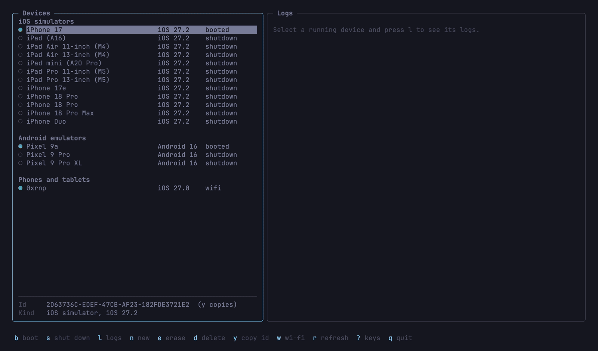

<p align="center">
  <picture>
    <source media="(prefers-color-scheme: dark)" srcset="assets/logo-dark.svg">
    <source media="(prefers-color-scheme: light)" srcset="assets/logo-light.svg">
    
  </picture>
</p>

# lazymobile

[](https://github.com/0xrnp/lazymobile/actions/workflows/ci.yml)
[](https://github.com/0xrnp/lazymobile/releases)
[](https://github.com/sponsors/0xrnp)

A terminal dashboard for mobile development: iOS simulators, Android emulators, connected phones,
their logs, and Expo builds, in one screen. `lazymobile run` starts your app on any of them with
the tool you already use, and `lazymobile mcp` gives a coding agent the same devices. It works in
any terminal, and inside Neovim or another editor's terminal.



<details>
<summary>More screenshots</summary>

The device list:


The log of one app on an Android emulator, with its crash in red:


Every key, with `?`:


</details>

## What it does

**Devices**
- One list of every simulator, emulator, iPhone and Android phone on the machine, with the disk
  each simulator and emulator uses.
- Boot, cold boot, shut down, erase, create and delete simulators and emulators, and delete the
  simulators Xcode can no longer run.
- Dark and light mode, screenshots and screen recordings on a simulator, emulator or Android phone,
  and a location and the tidy status bar of a screenshot on a simulator or emulator. Android phones
  connect over Wi-Fi too.

**Apps**
- Install an `.apk` or `.app` (on an iPhone too), launch, restart, stop and uninstall it.
- Grant or revoke a permission, clear an app's data, and open a deep link.
- Send a test push notification to an app on an iOS simulator.
- Inside an Expo project: list EAS builds, install a finished one, start and cancel builds.

**Logs and debugging**
- Live logs, filtered by app, level and text, as many side by side as you like. Crashes are red,
  and `e` jumps to the next error. An Android app is followed across restarts.
- The latest crash report of an app, on a simulator, an Android device or an iPhone.
- The app's CPU and memory in its log's heading (`M`).
- A bug report in one command: a screenshot, the last log lines, the crash report and the
  versions, in a new folder.
- For React Native on Android: reach Metro, open the developer menu, reload.

**Run your app**
- `lazymobile run` picks a device, starts it, and runs your app: a native Kotlin or Swift app with
  Gradle or Xcode, then installed and launched, or Flutter, React Native and Expo with their own
  tool, hot reload included. Your `package.json` scripts and your own command work too.
- `--here` runs it inside lazymobile with the app's log beside it. `ctrl+p` saves a screenshot or a
  recording and copies it, or copies the log to ask an AI about.

**Scripts and agents**
- Every feature is also a command, with `--json` for scripts.
- An MCP server for Claude Code, Cursor, Codex and other agents. It serves nothing that erases data.
- Tab completion for zsh, bash and fish, with your device names and app ids.
- `lazymobile doctor` says what is missing, and `doctor --fix` installs it after asking.

One binary, no daemon. It calls the tools you already have (`xcrun`, `adb`, `emulator`, `eas`).

Requirements: macOS or Linux. iOS needs macOS with Xcode. Android needs the Android SDK (Android
Studio or the command-line tools). The builds pane needs the `eas` command.

## Install

With [Homebrew](https://brew.sh), on macOS or Linux:

```sh
brew install 0xrnp/tap/lazymobile
```

With Go 1.27.4 or newer:

```sh
go install github.com/0xrnp/lazymobile/cmd/lazymobile@latest
```

Or download a binary for macOS or Linux from the
[releases page](https://github.com/0xrnp/lazymobile/releases), unpack it, and put `lazymobile` on
your `PATH`.

### First steps

```sh
lazymobile doctor     # what it found, and what is missing
lazymobile            # the dashboard: select a device, l for its logs, ? for every key
lazymobile run        # in your app's folder: run it on a device
```

### Tab completion

Tab completes the commands, their flags, device names (running devices first, with what each
is), the app ids you used before, and file names where a file goes. Add one line to your shell's
startup file:

```sh
source <(lazymobile completion zsh)        # ~/.zshrc, after compinit
eval "$(lazymobile completion bash)"       # ~/.bashrc
lazymobile completion fish | source        # ~/.config/fish/config.fish
```

## The dashboard

Run `lazymobile`, inside an Expo project to also get the builds pane. The devices are on the left
and the logs you open on the right. `?` lists every key, those of the focused pane first, and
runs the one you pick. The keys you will use most:

| Key | Action |
| --- | --- |
| `j` `k`, arrows | Move, or scroll a log |
| `b` `s` | Boot, shut down |
| `l`, `enter` | Open a log of the selected device, for one app or all of it |
| `o` | An app's menu: launch, restart, stop, crash report, bug report, permissions, push |
| `i` `u` | Install, uninstall |
| `p` `t` `m` | Screenshot, open a link, dark mode |
| `ctrl+p` | Quick menu: screenshot or recording to the clipboard, the log for an AI, bug report |
| `/` `L` | Filter a log, minimum level |
| `e` `E` | Next or previous error in a log |
| `M` | The app's CPU and memory in the log's heading |
| `tab` | Next pane |
| `q` | Quit. Simulators and emulators keep running |

Every key, the layouts for several logs, the mouse, and what is remembered per folder:
[docs/dashboard.md](docs/dashboard.md).

## Run your app

`lazymobile run` finds the device, starts it if it is off, and runs the app of the current folder on
it with the tool you already use. It shows the exact command, then hands the terminal over, so
`r` for hot reload and the other keys work as before.

```sh
lazymobile run                       # the device used here last time, else the one that is running
lazymobile run "Pixel 9a"            # start it if it is off, then run
lazymobile run "iPhone 17" -- --flavor dev     # flags after -- go to your tool
lazymobile run --here                # run it inside lazymobile, with its log beside it
lazymobile run --here --no-log       # the same, with the tool on the whole width (ctrl+p, then l, shows the log)
lazymobile run --split               # also open the dashboard in a pane beside this one
lazymobile run --choose              # ask again which way to run and which device
```

How it runs the app, the first that fits:

1. An action named `run` in `.lazymobile.json` (see [Project settings](#project-settings)). Its
   command is shown and needs `--yes`, because the file can come from a repository someone else
   wrote. `{device_id}` is replaced by the device:

   ```json
   {"actions": [{"name": "run", "command": ["make", "run-dev", "DEVICE={device_id}"]}]}
   ```

2. Your `package.json` scripts that run the app, such as `"ios": "expo run:ios"` or
   `"android": "react-native run-android"`. They run with your package manager (from the
   `packageManager` field, else the lock file, here or in a folder above), and the device is added
   to the script's own command, after `--` for npm. A platform no script covers, such as Android in
   a project with only an `ios` script, runs with the project's tool below.
3. Flutter (a `pubspec.yaml`): `flutter run -d <device>`.
4. Expo (`expo` in `package.json`): the project's own `expo run:ios` or `expo run:android` with
   `--device` (a simulator's UDID, an emulator's AVD name, or a phone's model). It uses the copy in `node_modules/.bin`, here or in a folder above for a monorepo,
   and downloads nothing.
5. React Native (`react-native` in `package.json`): the project's own `react-native run-ios --udid`
   or `run-android --device`.
6. A native Android app (a `gradlew`, and a module that applies `com.android.application`):
   `./gradlew :app:assembleDebug`, then `lazymobile install <device> app/build/outputs/apk/debug
   --launch`, which installs the APK and starts it under the id Gradle gave it. A project with
   product flavors names the one to build: `lazymobile run -- assembleDevDebug`. Android phones work
   too.
7. A native iOS app (an `.xcworkspace` or `.xcodeproj` in the folder or a folder in it, such as
   `iosApp`; one way to run per scheme):
   `xcodebuild -scheme <scheme> -configuration Debug -destination id=<simulator> build`, then
   `lazymobile install <simulator> <the built .app> --launch`. It builds where Xcode does
   (DerivedData), so a build made in Xcode is reused. Simulators only: an iPhone needs code
   signing, so run it from Xcode. The schemes come from the project's scheme files; a project with
   none is asked with `xcodebuild -list`, which takes a few seconds.

A folder with both, such as a Kotlin Multiplatform project, offers each on its own platform. The
build and install are one shell line, shown before it runs; to find where the app will be built,
lazymobile first asks `xcodebuild -showBuildSettings`, which can resolve the project's Swift
packages. `--here` shows the build in its pane and opens the app's log once it is launched.

When there are several ways, such as an `ios` and an `ios:release` script, or actions named
`run dev`, `run prod` and `run:staging`, it lists them once and remembers your answer for the folder. A device you name
leaves out the ways for the other platform. With no device named and more than one to choose from,
it lists the simulators and emulators (the ones running first) and remembers that too. A real phone
is listed only after the others, and is never remembered. `--profile <name>` picks a way without
asking. Without a terminal, such as in a script, it never asks: a plain `run` action is used, or it
stops and says to name one.

There are three ways to see your tool and the device together:

| | What you get | Where |
|---|---|---|
| `lazymobile run --here` | One window: your tool on the left, the app's log on the right, and the full dashboard a key away | Any terminal |
| `lazymobile run --split` | Your tool here, the dashboard in a new pane beside it | Rex, tmux, Zellij |
| `lazymobile run` and `lazymobile` | Your tool here, the dashboard in a second terminal you open | Any terminal |

### Inside lazymobile: `--here`

`lazymobile run --here` starts the dashboard on its run view. Your tool runs in the left pane on a
terminal of its own, so its colours, its QR code and its keys work as they do outside lazymobile.
The log of the app is on the right, and opens by itself once lazymobile knows the folder's app.

| Key | In the run view |
|---|---|
| any key | goes to your tool while its pane has the keys: `r` hot reload, `ctrl+c` stops it |
| `ctrl+]` | switch to the full dashboard (devices, logs, screenshots, bug report) and back; the tool keeps running |
| `ctrl+p` | the quick menu over the run view, from either pane: screenshot or recording to the clipboard, the log for AI, a bug report (see the key table above), and here also `l` to hide the log (the tool gets the whole width, `ctrl+o` shows the log by itself, and the folder remembers it) or show it again, and `+` and `-` to resize while the menu stays open. `--no-log` starts with the log hidden, for that run only |
| `ctrl+o` | give the keys to the log (filter `/`, level `L`, pause `p`, copy `y`) or back to the tool; `esc` goes back too |
| `l` | from the log, the first time: pick the app whose log to show |
| `shift+←`, `shift+→` | move the line between the panes, from either pane (the keys never reach your tool). Dragging the line with the mouse does too, and the folder remembers where it was left |
| `+`, `-` | the same, from the log |
| `z` | from the log: show it at full width, and again to show both |
| `shift+pgup`, `shift+pgdn`, the wheel | scroll back through the tool's output; typing goes back to the end |
| `enter` | after the tool ended: run it again |
| `q` | from the log, the dashboard or an ended tool: quit. While the tool runs it asks, then stops it (ctrl+c, then a kill after 5 seconds) so no dev server is left behind |

A click gives the keys to the pane clicked. Below 100 columns only one pane shows, the one with the
keys. lazymobile uses the mouse, so to select text with it, hold the key your terminal uses for
that, usually Shift (Option in some).

### More about `run`

- Keep the dashboard in a second terminal or split, in the same folder. When you start a run, it
  selects that device and opens the log of the app, so the tool's output and the device's log sit
  side by side. The first time it asks which app (press `l`, then pick it). After that it knows
  the app for the folder. A phone is selected, but its log is not opened for you. The dashboard
  only follows a run that began in the last 10 minutes and after you last used it.
- `--here` cannot be used with `--split`, and needs a terminal. It ends with exit code 0 when you
  quit: how the tool ended shows in its pane.
- `--split` opens that dashboard for you, in a new pane to the right of the terminal where you ran
  it, in the same folder, before your tool starts. It works in Rex, tmux and Zellij. In any other
  terminal it stops with a message and does not run your tool, so use a second terminal there. A
  tmux or Zellij inside a Rex terminal is split as tmux or Zellij.
- With no device named, it uses the simulator or emulator this folder was last run on, else the one
  that is running. With none or several running it asks you to name one. It never picks a real
  phone unless you name it, and never remembers one.

## For agents (MCP)

`lazymobile mcp` lets a coding agent boot a device, install and launch the app, take a screenshot,
and read the app's log and crash report. With Claude Code:

```sh
claude mcp add lazymobile -- lazymobile mcp
```

In Cursor, add `"lazymobile": { "command": "lazymobile", "args": ["mcp"] }` under `mcpServers` in
`.cursor/mcp.json`. Nothing that erases data is served: erase, delete, uninstall and clear data
stay on the command line, behind `--yes`.

[docs/coding-agents.md](docs/coding-agents.md) has the setup for Codex, VS Code and other
clients, the list of tools, what to ask an agent, and a skill file for agents that use the commands
instead.

## Commands

```sh
lazymobile list [--json]
lazymobile boot "Pixel 9a" --cold --wait
lazymobile boot "Pixel 9a" --wipe --yes
lazymobile boot "iPhone 17" --no-window
lazymobile shutdown "Pixel 9a"
lazymobile shutdown "iPhone 17" --keep-simulator-app
lazymobile erase "iPhone 17" --yes
lazymobile delete "iPhone 17" --yes
lazymobile delete --unavailable [--yes]   # simulators Xcode can no longer run: lists them with their size, deletes with --yes
lazymobile uninstall "Pixel 9a" com.example.app --yes   # the app and its data
lazymobile install "Pixel 9a" ./app.apk   # an .app folder for a simulator or an iPhone
lazymobile install "Pixel 9a" app/build/outputs/apk --launch   # the newest build in a folder, then start it
lazymobile launch "Pixel 9a" com.example.app [--restart]
lazymobile stop "Pixel 9a" com.example.app   # keeps the app's data
lazymobile appearance "Pixel 9a" [dark|light]   # no mode shows the current one (Android 10 or newer)
lazymobile permission "Pixel 9a" grant camera com.example.app   # camera, location, photos, notifications...
lazymobile cleardata "Pixel 9a" com.example.app --yes   # emulators; on iOS, uninstall instead
lazymobile location "Pixel 9a" 37.7749,-122.4194   # or: clear (simulators only)
lazymobile statusbar "iPhone 17" clean   # or: reset
lazymobile boot --all "iPhone*" "Pixel 9a" [--wait]         # several at once; a real phone is skipped
lazymobile install --all build/app.apk [--phones]           # on every running device that can take it
lazymobile boot --set matrix                                # a named set from .lazymobile.json
lazymobile action --list                                    # the commands in .lazymobile.json
lazymobile action "Pixel 9a" "Flutter run" --yes            # without --yes it only shows the command
lazymobile link "iPhone 17" "myapp://home?id=1&tab=2"
lazymobile dev "Pixel 9a" reverse|menu|reload [--port 8081]   # Android only: reach Metro, open the dev menu, reload
lazymobile screenshot "Pixel 9a" [--out shot.png]   # never replaces a file
lazymobile crash "Pixel 9a" com.example.app [--save crash.txt]   # the app's latest crash report, on an iPhone too
lazymobile push "iPhone 17" com.example.app [--title T --body B | --payload push.json]   # simulators
lazymobile report "Pixel 9a" com.example.app [--out bug] [--since 5m] [--lines 200]   # a folder for a bug report
lazymobile changelog [0.4.0] [--all] [--json]   # what changed in this version, one version, or all
lazymobile record "Pixel 9a" [--out clip.mp4] [--duration 30s]   # Ctrl-C stops it and keeps the video
lazymobile logs "Pixel 9a" --app com.example.app --level warning
lazymobile logs "iPhone 17" --app com.example.app --mode console --json
lazymobile logs "iPhone 17" --last-app   # the app id used most recently on iOS
lazymobile logs "Pixel 9a" --since 5m --tail 200   # read what was logged, print the last 200 lines, and end
lazymobile apps "iPhone 17" [--json]     # app ids used before, and the apps installed on it
lazymobile id "Pixel 9a"          # emulator-5554 when running
lazymobile builds [--json] [--limit 20] [--yes]   # --yes when .lazymobile.json sets the eas command
lazymobile doctor [--json]
lazymobile doctor --fix [--yes]     # shows each fix's command and asks before running it; --yes for scripts
lazymobile run [device] [-- tool flags]   # see Run your app
lazymobile mcp                      # the MCP server, on stdio
lazymobile completion zsh|bash|fish
```

A device is an id, an adb serial, a name, or a unique part of a name. Commands that erase,
delete, uninstall or clear data need `--yes`. Exit codes: 0 success, 1 failure, 2 wrong usage.

App ids given to `logs` and `launch` are remembered, newest first, and shared with the dashboard.

Every command takes `--json`, apart from `run`, `mcp`, `completion` and `version`. A failure is then printed on stdout as
`{"error": {"code", "message", "hint"}}`, with the same exit code, so a script can tell `not_found`
from `tool_missing`. `logs --json` prints one object per line (`text`, `level` from 1 verbose to 6
fatal, `pid`, and `crash` on the lines of a crash). Every shape is in [docs/json.md](docs/json.md).

## Project settings

Optional. A `.lazymobile.json` next to `eas.json` changes how `eas` is run:

```json
{
  "eas": {
    "command": ["pnpm", "exec", "eas"],
    "build_command": ["make", "eas-build-{profile}", "PLATFORM={platform}"]
  }
}
```

- `command`: how to run the eas CLI. By default the project's own copy
  (`node_modules/.bin/eas`) is used, then `eas` from your `PATH`.
- `build_command`: what starts a build, in place of `eas build`. Use it when your project starts
  builds through its own script, for example one that checks a release gate first. `{profile}`
  and `{platform}` are replaced.

The project is found by looking for `eas.json` in the current folder and its parents, up to the
repository root, and then in `apps/*/`.

### Sets of devices

`device_sets` names groups of devices, such as a test matrix, for `boot --set` and `install --set`:

```json
{ "device_sets": { "matrix": ["iPhone 17", "Pixel 9a", "Pixel Tablet*"] } }
```

- Each entry is a name, a part of a name, an id, or a pattern with `*` or `?` that matches the whole
  name (`iPhone*`), ignoring case. An entry that matches no device is an error, so a typo does not
  drop a device from the run.
- A set only names devices. It never holds a command.
- `boot --all` and `install --all` work on up to three devices at a time and print one line for
  each: `ok`, `skipped` (already running, a real phone, not running, the wrong kind of build) or
  `failed`. The exit code is 1 if any failed. `install --all` goes to every running simulator and
  emulator that can take the build. Real phones are only included with `--phones`.

### Your own commands

`actions` adds commands of your own to the dashboard (`R`) and to `lazymobile action`:

```json
{
  "actions": [
    { "name": "Flutter run", "command": ["flutter", "run", "-d", "{device_id}"] },
    { "name": "Install debug", "platform": "android", "command": ["./gradlew", "installDebug"] },
    { "name": "Clear app", "command": ["adb", "-s", "{device_id}", "shell", "pm", "clear", "{app}"] }
  ]
}
```

- `command` is a list of arguments, not a shell line, so nothing is split or expanded for you. In
  the arguments after the first, `{device_id}` is what the platform's own tool wants (`flutter -d`,
  `adb -s`, `xcrun simctl`), `{platform}` is `ios` or `android`, and `{app}` is the app id you last
  used on that platform (`--app` on the command line).
- `platform` is optional. It shows the action only for `android` or `ios` devices.
- The command runs in the folder of the file that defines it. The file is read from the folder you
  started lazymobile in and the folders above it, up to the repository root. If two files use the
  same name, the nearer one wins.
- A mistake in the file (an unknown placeholder, a missing name, two actions with one name) is
  reported, and nothing runs.
- **A file like this can come from a repository you cloned**, so a command never runs unseen. The
  dashboard shows the command and the folder and waits for `y`. The command line refuses without
  `--yes`. There is no "always allow". Read the file before you run its actions.
- The same trust applies to `eas.command` above. When it comes from this file, the builds pane
  shows it and asks before the first load, and `lazymobile builds` needs `--yes`. `build_command`
  is already shown in the window that asks before a build starts.

## In Neovim

This repository is also a Neovim plugin (0.10 or newer). It opens lazymobile in a floating
terminal, the way lazygit.nvim does. With lazy.nvim:

```lua
{
  "0xrnp/lazymobile",
  cmd = "Lazymobile",
  keys = { { "<leader>m", "<cmd>Lazymobile<cr>", desc = "lazymobile" } },
  opts = {}, -- optional: { cmd = { "lazymobile", "--keep-simulator-app" }, width = 0.9, height = 0.9, border = "rounded", toggle_key = "<C-q>" }
}
```

The plugin only opens the program, so install the `lazymobile` binary as well (see Install).

`:Lazymobile` opens it in Neovim's current folder, so inside an Expo project the builds pane is
there.

- `<C-q>` inside the window hides it while lazymobile keeps running, so a log keeps streaming.
  `:Lazymobile` (or your key) brings it back as it was. Set `toggle_key` to change the key, or to
  `false` for none.
- `q` quits lazymobile and closes the window. The next start in the same folder puts back the
  device and the log you had open (see "Where you left off").
- If lazymobile cannot start, the window stays open with its message.

If you map `<Esc>` in terminal mode, lazymobile does not receive it. Its windows also close with
`ctrl+c`.

## Safety

- Erase, delete, wipe and uninstall always ask first. Real phones are never booted, shut down,
  erased or deleted. On them lazymobile only uninstalls an app (only one you installed: the apps
  that come with the system are refused), installs a build you name, launches, restarts or stops an app, copies an iPhone's crash reports (never removing them), and, on an Android
  phone, opens a link, takes a screenshot or switches dark mode. A location, a status bar, an app's permissions and its data are only changed on simulators and emulators.
- A screenshot or a recording never replaces a file, and is readable only by you, since a screen can show
  personal data. A link is checked before it reaches an Android phone's shell.
- The builds pane does not run `eas` until you press `enter` in it. `eas` runs your project's
  own configuration code and uses your Expo login, so it is never started just by opening the
  dashboard.
- Starting a build shows the exact command and asks first, because it uses build time on your
  Expo account. A profile with "prod" in its name must be typed out to confirm.
- `lazymobile run` shows the command before it starts it, and a `package.json` script's own text.
  The script runs as it would if you typed `npm run`, so read the scripts of a project you cloned
  before you run it. A command
  from `.lazymobile.json` needs `--yes`.
- Log lines are stripped of terminal control sequences before they are drawn.
- Saved logs are readable only by you, since logs can hold tokens and personal data.
- One thing asks the network: the dashboard looks for a newer release, at most once a day, with a
  plain request to GitHub's public release list of this repository (`api.github.com`). The request
  has no query, no login and no version of yours, and its user agent is `lazymobile`, though GitHub
  sees the address it comes from, as with any request. A newer version shows as one line at the
  bottom. Set `LAZYMOBILE_NO_UPDATE_CHECK=1` to never look. A build made from source, in between
  releases, never looks, and the plain commands never do.

## Status

lazymobile is young (0.x), and says plainly what has been run. Every feature has tests against
fake tools built from real output, and most were also run on a real iOS 27.2 simulator and a real
Android 16 emulator. [docs/tested.md](docs/tested.md) lists, feature by feature, what was run for
real, on what, and what was not. The least tried: Android phones other than one, an iPhone's logs,
Xcode versions other than 27.2, and Linux beyond the dashboard.

If something fails for you, please
[open an issue](https://github.com/0xrnp/lazymobile/issues/new/choose) with the output of
`lazymobile doctor`.

### Supported versions

lazymobile runs on macOS and Linux. Windows is not supported. iOS needs macOS with Xcode.

| | Run for real | Meant to work, not run |
| --- | --- | --- |
| Xcode | 27.2 | 26 and earlier: the simulator window opens in Simulator.app, not DeviceHub. Tests cover both, with fake tools. iPhones need Xcode 15 or newer (`devicectl`) |
| Android | Android 16 emulator, a real phone | Older and newer versions. Apps are listed with `pm list packages -3` and started and stopped with `monkey` and `am force-stop`, which older releases also have |
| Linux | The dashboard, and Homebrew in a container | Every distribution |

A version in the right column has not been run. If you use one, say what happened in an
[issue](https://github.com/0xrnp/lazymobile/issues/new/choose) with the output of
`lazymobile doctor`.

## Troubleshooting

Run `lazymobile doctor` first.

- **No Android devices**: the SDK was not found. Set `ANDROID_HOME`.
- **Phone shows "unauthorized"**: unlock it and accept the USB debugging prompt.
- **Linux: "no permissions"**: install udev rules for Android devices (`android-udev-rules`).
- **Simulators stop when DeviceHub quits (Xcode 27)**: that is DeviceHub's "Stop simulators on
  quit" setting. Turn it off in DeviceHub's settings.
- **Simulator or DeviceHub quits after a simulator shuts down**: once no simulator is running,
  lazymobile quits them, which closes the window they keep open for a shut-down simulator. macOS
  asks once whether your terminal may control them. To keep them open, start lazymobile with
  `--keep-simulator-app` (the dashboard and `shutdown` both take it).
- **iPhone shows "disconnected"**: connect it once by cable, trust the computer, and turn on
  Developer Mode in Settings > Privacy & Security.
- **Creating an Android emulator fails about Java**: install a JDK 17 or newer, or set
  `JAVA_HOME`.
- **Builds pane says you are not logged in**: run `eas login`.
- **Builds pane says the app config could not be loaded**: `eas` never reads `.env` files. If
  your `app.config` requires variables from `.env`, set them in your shell, or put them in the
  command in `.lazymobile.json`, for example
  `["env", "EXPO_PUBLIC_API_URL=https://example.com", "npx", "eas"]`.
- **Copy does nothing**: copying uses the terminal's clipboard support (OSC 52). In tmux, turn on
  `set -g set-clipboard on`.

## Development

```sh
make check    # formatting, vet, staticcheck, and the tests with the race detector
make vuln     # known vulnerabilities (needs the network)
make build    # ./lazymobile
```

The tests use fake tools, so they run anywhere and never touch a real device or an Expo account.
A fix for a parsing or tool-output problem should come with a test built from the real output,
with names and ids replaced.

`make devices` is the exception: it drives `lazymobile mcp` through its tools on a real simulator
and emulator, with a small app it builds from `cmd/lazymobile/testdata/testapp` (Xcode for iOS, the
Android SDK and a JDK for Android). Name the devices it may use:

```sh
LAZYMOBILE_TEST_IOS=<simulator id> LAZYMOBILE_TEST_ANDROID=<emulator name> make devices
```

It installs the app, crashes it on purpose and removes it again, and refuses a real phone.
Afterwards it puts the appearance back, resets the status bar, clears a simulator's location, and
shuts down a device it started. Left behind: the location of an emulator (it cannot forget one),
Android's permission for demo status bars, the crash in Android's own crash records, and a
Simulator window that `boot` opened. If the test is stopped by its time limit, nothing is put back.

The name follows the convention of lazygit and lazydocker. This project is not affiliated with
them.

Changes are welcome: see [CONTRIBUTING.md](CONTRIBUTING.md). Security problems go to
[SECURITY.md](SECURITY.md).

## Support

lazymobile is free and MIT licensed. If it saves you time,
[sponsoring it on GitHub](https://github.com/sponsors/0xrnp) helps keep it maintained. Most of
the "not run" entries in [docs/tested.md](docs/tested.md) are hardware: Android phones from other
makers, older iPhones and other Xcode versions, and sponsorship helps test on them.

Other ways to help, which cost nothing:

- Star the repository, so other mobile developers find it.
- Try a feature that [docs/tested.md](docs/tested.md) lists as not run on your device, and say in
  an issue what happened.
- Report a bug with the output of `lazymobile doctor`, or send a fix (see
  [CONTRIBUTING.md](CONTRIBUTING.md)).

Thanks to everyone who has
[contributed](https://github.com/0xrnp/lazymobile/graphs/contributors) or
[sponsored](https://github.com/sponsors/0xrnp).

## License

MIT
