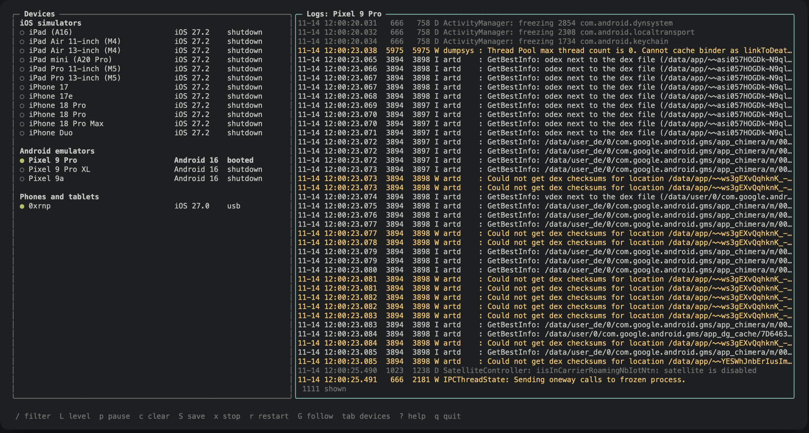
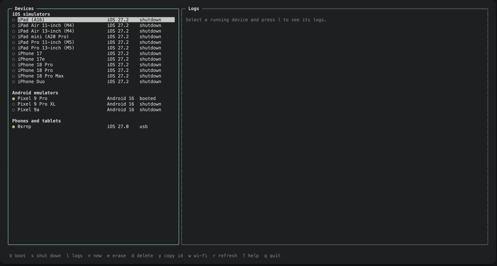
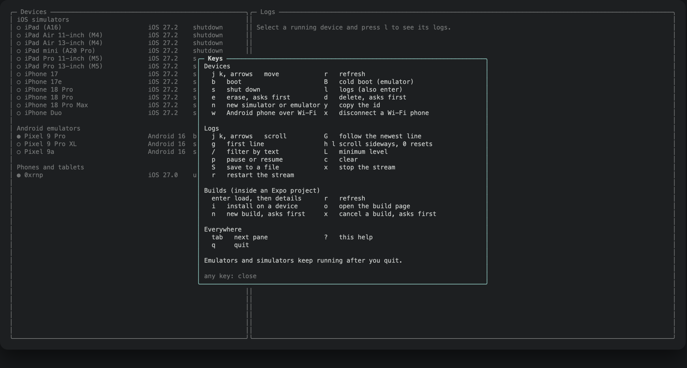

# lazymobile

[](https://github.com/0xrnp/lazymobile/actions/workflows/ci.yml)

A terminal dashboard for mobile development: iOS simulators, Android emulators, connected phones,
their logs, and Expo builds, in one screen. It works in any terminal, and inside Neovim or
another editor's terminal.



<details>
<summary>More screenshots</summary>

The device list:



The keys, shown over the dashboard with `?`:



</details>

- One list for every simulator, emulator, iPhone and Android phone on the machine.
- Boot, cold boot, shut down, erase, create and delete simulators and emulators.
- Connect Android phones over Wi-Fi (pairing code or address).
- Live logs for one device: filter by app, level and text. An Android app is followed across
  restarts.
- Inside an Expo project: list EAS builds, install a finished build on a running simulator or
  emulator, start and cancel builds.
- The same features as plain commands, with `--json`, for scripts and coding agents.
- `lazymobile doctor` says what is missing and how to install it.
- One binary. It calls the tools you already have (`xcrun`, `adb`, `emulator`, `eas`).

Requirements: macOS or Linux. iOS needs macOS with Xcode. Android needs the Android SDK (Android
Studio or the command-line tools). The builds pane needs the `eas` command.

## Status

Early release. What has been run, and what has not:

| | Tested |
| --- | --- |
| Unit tests | Full suite on macOS, with fake `xcrun`, `adb`, `emulator` and `eas`. CI runs it on Ubuntu and macOS |
| Listing devices, `doctor`, opening the dashboard | Real Xcode 27.2 and Android SDK on macOS |
| Android emulator logs (`logcat`) | A real emulator on macOS |
| Boot, shut down, erase, create, delete, iOS logs | Fake tools only in this program. The same commands were run on real simulators and emulators in [devices.nvim](https://github.com/0xrnp/devices.nvim), which this logic is ported from |
| Expo builds pane | Fake `eas` only, written against the output of eas-cli 24. Not yet run against a real Expo account |
| iPhones | Listed over USB with a real iPhone. Its logs have only been tried with fake tools |
| Android phones (USB, Wi-Fi), `idevicesyslog` | Fake tools only. No real device has been tried |
| Linux | Cross-compiled, and the suite runs in CI. Not tried by hand |

If something fails for you, please
[open an issue](https://github.com/0xrnp/lazymobile/issues/new/choose) with the output of
`lazymobile doctor`.

## Install

With Go 1.26.7 or newer:

```sh
go install github.com/0xrnp/lazymobile/cmd/lazymobile@latest
```

Or download a binary for macOS or Linux from the
[releases page](https://github.com/0xrnp/lazymobile/releases), unpack it, and put `lazymobile` on
your `PATH`.

Then run `lazymobile doctor` to see what it found.

## The dashboard

Run `lazymobile`. Run it inside an Expo project to also get the builds pane.

Devices:

| Key | Action |
| --- | --- |
| `j` `k`, arrows | Move |
| `b` | Boot |
| `B` | Cold boot an emulator (ignore its snapshot) |
| `s` | Shut down |
| `l`, `enter` | Logs |
| `e` | Erase a simulator, or wipe an emulator's data. Asks first |
| `d` | Delete. Asks first |
| `n` | New simulator or emulator |
| `y` | Copy the id for `adb -s`, `flutter -d`, `xcrun` |
| `w` | Pair or connect an Android phone over Wi-Fi |
| `x` | Disconnect a Wi-Fi phone |
| `r` | Refresh |

Logs:

| Key | Action |
| --- | --- |
| `j` `k`, arrows | Scroll |
| `G` | Jump to the end and follow |
| `g` | First line |
| `h` `l`, `0` | Scroll sideways, reset |
| `/` | Filter by text (empty clears) |
| `L` | Minimum level |
| `p` | Pause or resume (nothing is lost) |
| `c` | Clear |
| `S` | Save what is shown to a file |
| `x` | Stop the stream |
| `r` | Restart the stream |

Builds (inside an Expo project):

| Key | Action |
| --- | --- |
| `enter` | Load the builds, then show a build's details |
| `i` | Download a finished build and install it on a running device |
| `o` | Open the build's page on expo.dev |
| `n` | Start a build. Shows the exact command and asks first |
| `x` | Cancel a build that is waiting or running. Asks first |
| `r` | Refresh |

Everywhere: `tab` moves to the next pane, `?` shows the keys, `q` quits. Simulators and emulators
keep running after you quit.

What each device offers for logs:

| Device | Logs |
| --- | --- |
| Android emulator or phone | `logcat`, optionally only one app (package name) |
| iOS simulator | System log, optionally one app (bundle id). Or launch the app and show its output |
| iPhone | Launch the app and show its output. Or the system log (needs `idevicesyslog`) |

When you give an Android package, the log keeps following the app when it restarts and gets a
new process id, and keeps crash reports and system messages that name it.

A release iOS app's `print()` and `NSLog` output goes to its standard output, which only the tool
that launched it sees. Choose "Launch an app and show its output" to see it.

## Safety

- Erase, delete and wipe always ask first. Real phones are never booted, erased or deleted.
- The builds pane does not run `eas` until you press `enter` in it. `eas` runs your project's
  own configuration code and uses your Expo login, so it is never started just by opening the
  dashboard.
- Starting a build shows the exact command and asks first, because it uses build time on your
  Expo account. A profile with "prod" in its name must be typed out to confirm.
- Log lines are stripped of terminal control sequences before they are drawn.
- Saved logs are readable only by you, since logs can hold tokens and personal data.

## Commands

```sh
lazymobile list [--json]
lazymobile boot "Pixel 9a" --cold --wait
lazymobile boot "Pixel 9a" --wipe --yes
lazymobile boot "iPhone 17" --no-window
lazymobile shutdown "Pixel 9a"
lazymobile erase "iPhone 17" --yes
lazymobile delete "iPhone 17" --yes
lazymobile install "Pixel 9a" ./app.apk
lazymobile logs "Pixel 9a" --app com.example.app --level warning
lazymobile logs "iPhone 17" --app com.example.app --mode console --json
lazymobile id "Pixel 9a"          # emulator-5554 when running
lazymobile builds [--json] [--limit 20]
lazymobile doctor [--json]
```

A device is an id, an adb serial, a name, or a unique part of a name. Commands that erase or
delete data need `--yes`. Exit codes: 0 success, 1 failure, 2 wrong usage.

`logs --json` prints one object per line (`text`, `level` from 1 verbose to 6 fatal, `pid`), which
is easy for a script or a coding agent to read.

## Project settings

Optional. A `.lazymobile.json` next to `eas.json` changes how `eas` is run:

```json
{
  "eas": {
    "command": ["pnpm", "exec", "eas"],
    "build_command": ["make", "eas-build-{profile}", "PLATFORM={platform}"]
  }
}
```

- `command`: how to run the eas CLI. By default the project's own copy
  (`node_modules/.bin/eas`) is used, then `eas` from your `PATH`.
- `build_command`: what starts a build, in place of `eas build`. Use it when your project starts
  builds through its own script, for example one that checks a release gate first. `{profile}`
  and `{platform}` are replaced.

The project is found by looking for `eas.json` in the current folder and its parents, up to the
repository root, and then in `apps/*/`.

## In Neovim

lazymobile is a normal terminal program, so it runs in a floating terminal the way lazygit does.
Without a plugin (Neovim 0.10 or newer):

```lua
vim.keymap.set("n", "<leader>m", function()
  local buf = vim.api.nvim_create_buf(false, true)
  local width = math.floor(vim.o.columns * 0.9)
  local height = math.floor(vim.o.lines * 0.9)
  local win = vim.api.nvim_open_win(buf, true, {
    relative = "editor",
    style = "minimal",
    border = "rounded",
    width = width,
    height = height,
    row = math.floor((vim.o.lines - height) / 2),
    col = math.floor((vim.o.columns - width) / 2),
  })
  local function close()
    if vim.api.nvim_win_is_valid(win) then
      vim.api.nvim_win_close(win, true)
    end
    if vim.api.nvim_buf_is_valid(buf) then
      vim.api.nvim_buf_delete(buf, { force = true })
    end
  end
  if vim.fn.has("nvim-0.11") == 1 then
    vim.fn.jobstart({ "lazymobile" }, { term = true, on_exit = close })
  else
    vim.fn.termopen({ "lazymobile" }, { on_exit = close })
  end
  vim.cmd.startinsert()
end, { desc = "lazymobile" })
```

If you already use a terminal plugin (snacks.nvim, toggleterm.nvim and others), open
`lazymobile` in its floating terminal instead.

## Troubleshooting

Run `lazymobile doctor` first.

- **No Android devices**: the SDK was not found. Set `ANDROID_HOME`.
- **Phone shows "unauthorized"**: unlock it and accept the USB debugging prompt.
- **Linux: "no permissions"**: install udev rules for Android devices (`android-udev-rules`).
- **Simulators stop when DeviceHub quits (Xcode 27)**: that is DeviceHub's "Stop simulators on
  quit" setting. Turn it off in DeviceHub's settings.
- **iPhone shows "disconnected"**: connect it once by cable, trust the computer, and turn on
  Developer Mode in Settings > Privacy & Security.
- **Creating an Android emulator fails about Java**: install a JDK 17 or newer, or set
  `JAVA_HOME`.
- **Builds pane says you are not logged in**: run `eas login`.
- **Copy does nothing**: copying uses the terminal's clipboard support (OSC 52). In tmux, turn on
  `set -g set-clipboard on`.

## Development

```sh
make check    # formatting, vet, and the tests with the race detector
make build    # ./lazymobile
```

The tests use fake tools, so they run anywhere and never touch a real device or an Expo account.
A fix for a parsing or tool-output problem should come with a test built from the real output,
with names and ids replaced.

The name follows the convention of lazygit and lazydocker. This project is not affiliated with
them.

## License

MIT
